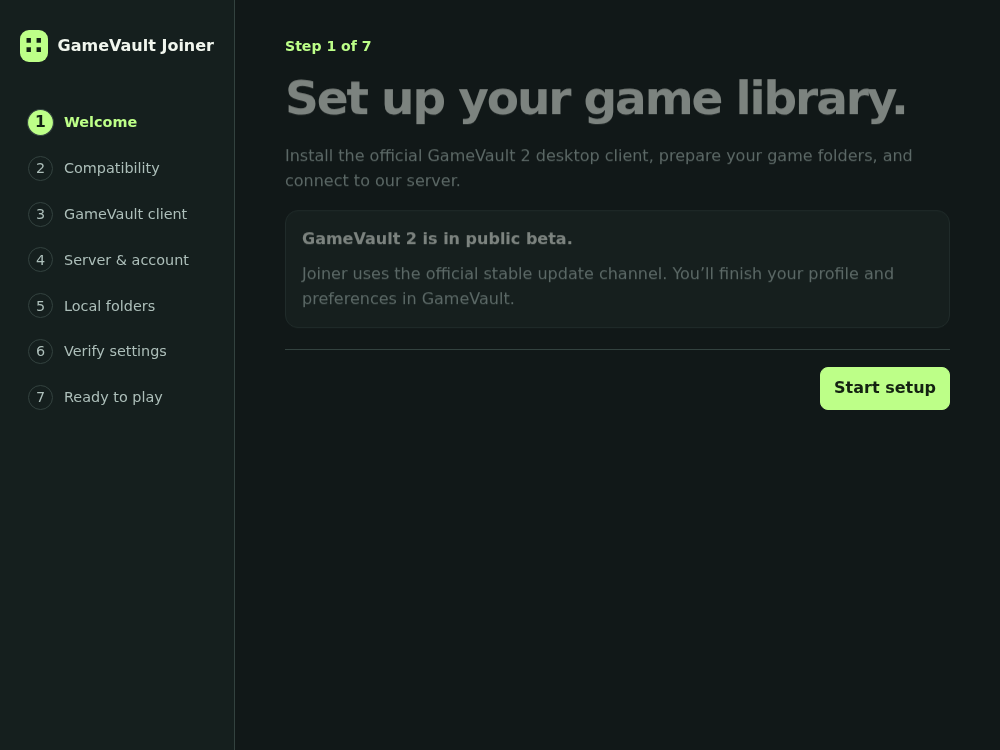
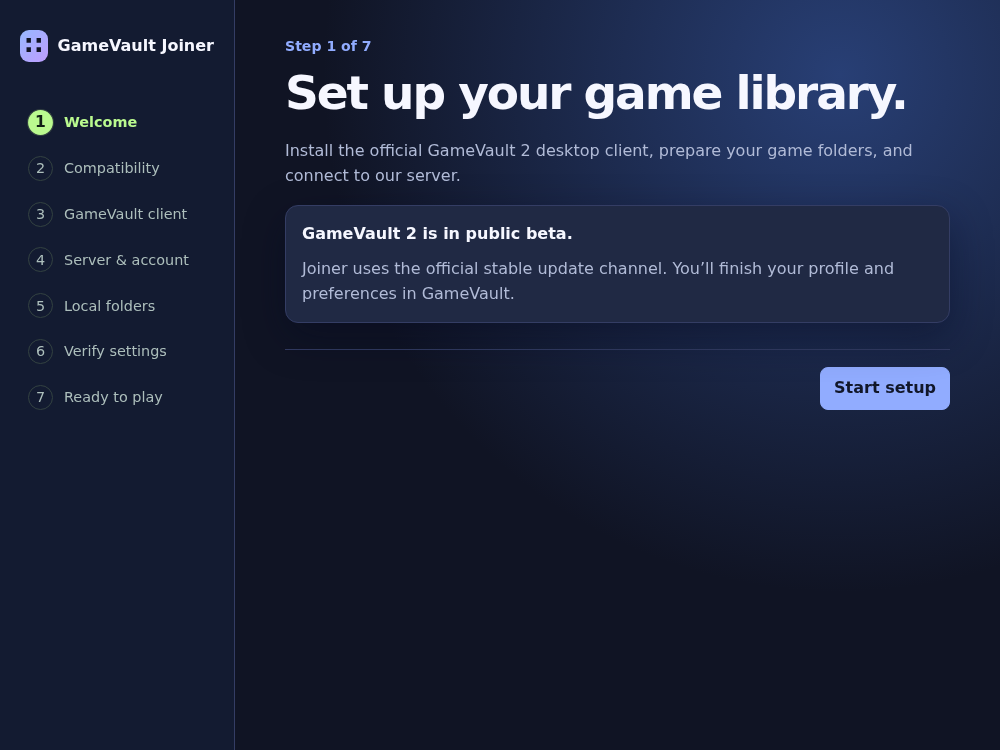

# GameVault Joiner

A desktop setup assistant for the [GameVault server](https://gamevault.pcenthusiast.blog), plus the source for its planned [download website](https://join.gamevault.pcenthusiast.blog).

Download the [latest installers](https://github.com/doopydoop364/gamevault-joiner/releases/latest) directly from GitHub.

Joiner downloads the official GameVault 2 stable-channel package directly from Phalcode, verifies its published SHA-256 digest, and opens the system installer or AppImage. GameVault 2 itself is in public beta.

## Interface previews

**Arcade green** is the current Joiner design. The wizard uses short transitions between steps and follows your system's reduced-motion preference.

**Midnight blue** is an alternate design concept for comparison. It is a preview, not a theme option in the released app.

## Supported platforms

| Operating system | CPU | Packages |
| --- | --- | --- |
| Windows 10 (1709+) / 11 | x64 | NSIS setup |
| Linux desktop | x64 | AppImage or DEB |
| macOS | Apple Silicon ARM64 | DMG |

Joiner creates and checks `~/GameVault/Downloads` and `~/GameVault/Games`, with custom locations available. GameVault 2 uses one library root per game for archives, extraction, and installation. The wizard guides users to choose `Games` as their root (or keep their existing root) and reserves `Downloads` for separate use.

- [Installation and account setup](docs/installation.md)
- [Troubleshooting](docs/troubleshooting.md)
- [Development and releases](docs/development.md)
- [Server and website deployment](docs/deployment.md)
- [Security](docs/security.md)
- [Implementation and validation status](PROJECT_STATUS.md)
